# 📐 Arquitectura AWS 100% Serverless con Cifrado E2E - CitasAcudientes

Plataforma móvil para agendamiento de citas entre **acudientes** (solicitantes) y **profesores** (atención).

Arquitectura orientada a peticiones síncronas de baja latencia **sin DynamoDB Streams**, con **cifrado en tránsito (TLS 1.3)** y **cifrado en reposo (AWS KMS)** de extremo a extremo.

---

## 🔒 1. Estrategia de Cifrado (En Tránsito y en Reposo)

La arquitectura garantiza que ningún dato sensible (nombres de estudiantes, motivos de citación, teléfonos o acuerdos académicos) viaje o resida en texto plano:

```
[ Celular ] ──(TLS 1.3)──> [ CloudFront ] ──(OAC + TLS 1.3)──> [ S3 (SSE-KMS) ]
     │
     └──(TLS 1.3)──> [ API Gateway ] ──(TLS 1.3 / SigV4)──> [ Lambda ] ──(TLS 1.3)──> [ DynamoDB (KMS) ]
```

### A. Cifrado en Tránsito (In-Transit Encryption)
| Tramo de Comunicación | Protocolo / Mecanismo | Configuración de Seguridad |
| :--- | :--- | :--- |
| **Móvil ↔ CloudFront** | HTTPS / TLS 1.3 | Certificado SSL/TLS administrado por **AWS Certificate Manager (ACM)**. Redirección forzosa de HTTP a HTTPS (puerto 443). |
| **CloudFront ↔ S3** | HTTPS / TLS 1.3 | Autenticación criptográfica mediante **Origin Access Control (OAC)** con firma AWS SigV4. El bucket deniega cualquier conexión no cifrada (`aws:SecureTransport: false`). |
| **Móvil ↔ API Gateway** | HTTPS / TLS 1.2+ / 1.3 | API REST con TLS forzado y verificación de tokens JWT en el encabezado `Authorization`. |
| **API Gateway ↔ Lambda** | Red Interna AWS / TLS | Invocación síncrona mediante AWS Lambda Proxy Integration a través de canales internos cifrados. |
| **Lambda ↔ DynamoDB** | HTTPS / TLS 1.3 | Peticiones del AWS SDK dirigidas al endpoint regional de DynamoDB sobre sesiones TLS 1.3. |

### B. Cifrado en Reposo (At-Rest Encryption)
| Servicio | Mecanismo | Detalle de Implementación |
| :--- | :--- | :--- |
| **Amazon S3** | **SSE-KMS** | Cifrado del lado del servidor con clave gestionada por el cliente (**Customer Managed Key - CMK**) en AWS KMS. Cada objeto (HTML, JS, CSS) se cifra con AES-256. |
| **Amazon DynamoDB** | **AWS KMS** | Cifrado nativo transparente en la tabla `CitasAcudientesTable`, índices secundarios (GSI), claves y copias de seguridad usando claves KMS. |
| **AWS Lambda** | **AWS KMS** | Código fuente de la función y variables de entorno de conexión cifradas en reposo con claves KMS. |

---

## 🚀 2. Flujo de Entrada Paso a Paso (End-to-End)

El siguiente flujo detalla el camino completo desde que el acudiente abre la aplicación en su teléfono móvil hasta que la cita queda asegurada en la base de datos:

```mermaid
sequenceDiagram
    autonumber
    actor A as 📱 Acudiente (Celular)
    participant CF as ⚡ CloudFront (CDN)
    participant S3 as 🪣 S3 (PWA Assets - KMS)
    participant GW as 🚪 API Gateway (REST)
    participant L as ⚙️ Lambda (AgendarCita)
    participant DB as 🗄️ DynamoDB (KMS)

    %% Fase 1: Descarga
    rect rgb(20, 30, 45)
    Note over A, S3: FASE 1: Carga y Descarga de la Aplicación Móvil
    A->>CF: 1. Abre https://citas.colegio.edu.co (HTTPS / TLS 1.3)
    CF->>S3: 2. Solicita index.html y bundles JS (OAC + HTTPS)
    S3-->>CF: 3. Desencripta con KMS y entrega assets
    CF-->>A: 4. Entrega PWA en caché local del teléfono
    end

    %% Fase 2: Petición de Cita
    rect rgb(30, 40, 25)
    Note over A, DB: FASE 2: Solicitud y Guardado de la Cita
    A->>GW: 5. POST /citas { docenteId, fecha, hora, motivo } (TLS 1.3)
    GW->>GW: 6. Valida JSON Schema, CORS y Token JWT
    GW->>L: 7. Invoca síncronamente Lambda AgendarCitaFn (Payload)
    L->>L: 8. Valida regla de negocio y prepara TransactWriteItems
    L->>DB: 9. TransactWriteItems (Insert Cita + Bloqueo Slot) (TLS 1.3)
    DB->>DB: 10. Evalúa condición atómica y cifra datos en disco con AWS KMS
    DB-->>L: 11. Confirmación de escritura transaccional ACID (200 OK)
    L-->>GW: 12. Retorna respuesta HTTP 201 Created { idCita, estado: "SOLICITADA" }
    GW-->>A: 13. Retorna JSON al celular del acudiente (TLS 1.3)
    end
    Note over A: La pantalla del celular muestra la cita confirmada instantáneamente
```



---

## 🔗 3. Matriz de Relación entre Componentes

| Componente Origen | Componente Destino | Tipo de Conexión | Propósito de la Relación |
| :--- | :--- | :--- | :--- |
| **Navegador Celular** | **Amazon CloudFront** | HTTPS / TLS 1.3 | Descarga inicial de la aplicación PWA y recursos estáticos. |
| **Amazon CloudFront** | **Amazon S3** | HTTPS / OAC | Acceso privado a los archivos web compilados. S3 no tiene IP ni DNS público. |
| **PWA Celular (JS Fetch)** | **Amazon API Gateway** | HTTPS / TLS 1.3 | Envío de solicitudes de citas (`POST /citas`) y consulta de horarios (`GET /disponibilidad`). |
| **Amazon API Gateway** | **AWS Lambda** | Integración Proxy AWS | Enrutamiento seguro del payload validado hacia la función de negocio respectiva. |
| **AWS Lambda** | **Amazon DynamoDB** | AWS SDK (HTTPS TLS 1.3) | Ejecución directa de operaciones atómicas (`TransactWriteItems`, `Query`, `UpdateItem`). |
| **AWS IAM / KMS** | **Todos los servicios** | Políticas de Menor Privilegio | Otorga permisos estrictos para lectura/escritura y uso de llaves criptográficas. |

---

## 🗄️ 4. Modelo de Datos DynamoDB (Sin Streams)

Tabla única: **`CitasAcudientesTable`** con capacidad bajo demanda (`PAY_PER_REQUEST`).

| Entidad | Partition Key (`PK`) | Sort Key (`SK`) | Atributos |
| :--- | :--- | :--- | :--- |
| **Docente** | `DOCENTE#<id>` | `METADATA` | Nombre, Asignatura, Grados, Email |
| **Franja Horaria** | `DOCENTE#<id>` | `SLOT#<fecha>#<hora>` | `estado: "LIBRE" \| "RESERVADO"`, Aula |
| **Cita Agendada** | `CITA#<id>` | `METADATA` | DocenteId, AcudienteId, Estudiante, Fecha, Hora, Estado, Motivo |
| **Acudiente** | `ACUDIENTE#<id>` | `METADATA` | Nombre, Teléfono, Estudiantes |

### Transacción Anti-Doble Reserva (`TransactWriteItems`)
Cuando el acudiente envía la solicitud, Lambda ejecuta una transacción atómica que:
1. Crea el registro `CITA#<id>`.
2. Actualiza el estado del horario a `"RESERVADO"`, verificando la condición `estado = :libre`.

Si dos acudientes pulsan "Reservar" en el mismo milisegundo, la base de datos aprueba solo uno y rechaza el segundo inmediatamente, devolviendo un error claro al teléfono sin inconsistencias.

---

## 🖥️ 5. Visualizador Interactivo HTML

Se actualizó el diagrama interactivo eliminando los componentes innecesarios (Streams) e incorporando la barra de pasos y badges de cifrado:
👉 **[Ver Diagrama Interactivo de Arquitectura (HTML)](file:///C:/Users/Yoimer%20Barrera/ACME/citasacudientes/docs/arquitectura.html)**
